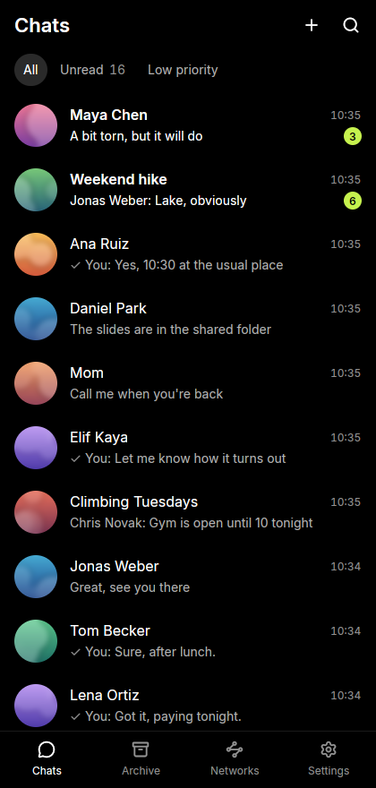
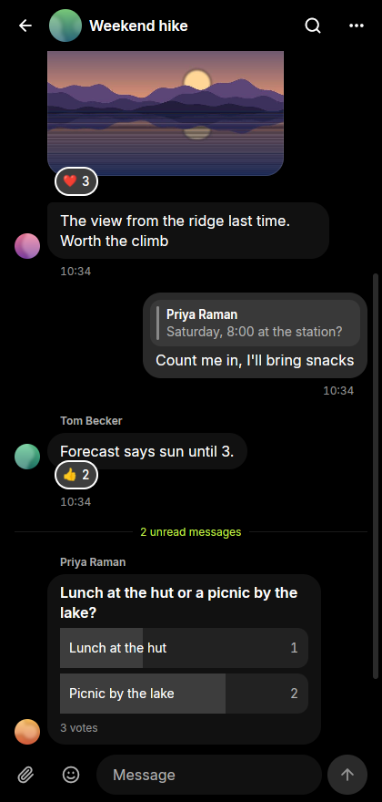
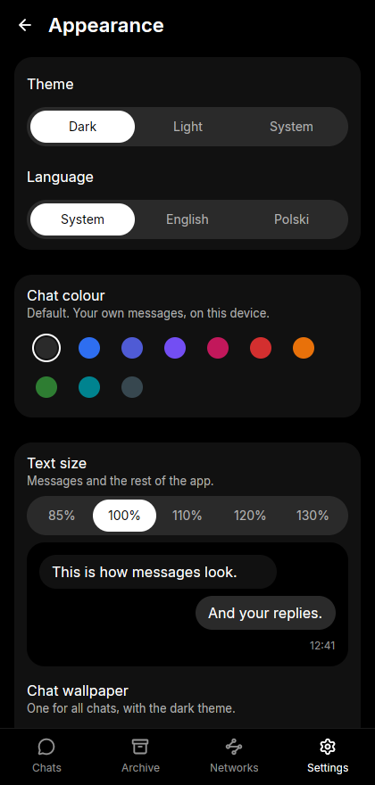
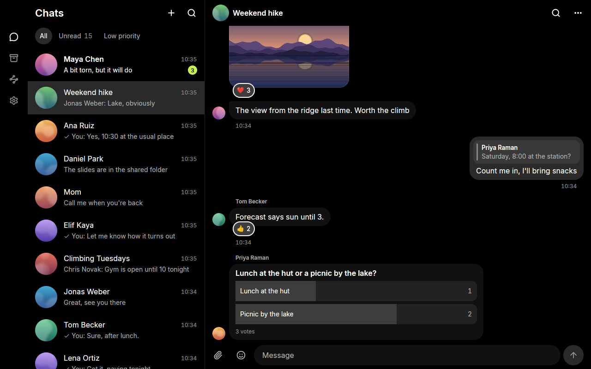

  

<h1 align="center">Unisend</h1>

A privacy-first Matrix chat client for Android and the Linux desktop.

Unisend is written in Rust with [GPUI](https://www.gpui.rs). Android is the main target, and it
runs on the Linux desktop too. It works with any Matrix homeserver and with Beeper accounts, whose
bridges bring WhatsApp, Signal, Messenger, Instagram, Telegram and other networks into one inbox.

  
  
  

  

## Features

### Chats

- Replies, reactions, edits, delete for everyone or only for you, forward to up to 5 chats
- Markdown formatting when you type, mentions, drafts kept per chat
- Polls (create, vote, end), contact cards, disappearing messages where the network allows them
- Read and typing state, hidden from others by default ("Hide reading and typing")
- Archive, pin, mute for a set time, mark as unread, swipe actions on chat rows
- Message requests and invitations to accept, decline or block
- Groups: add and remove members, change the name and picture, where your role allows it
- Search across all chats in a local index on the device
- Note to self, the same chat Beeper keeps
- Messages you send wait in a queue that survives going offline and restarting the app

### Media

- Photos, videos and files, with a caption; drag and drop or paste on desktop
- Full-screen picture viewer with zoom; a video player on Android
- Voice messages: recorded and played in the chat on Android and Linux
- Emoji picker with search, recents and skin tones; a GIF picker in builds with a KLIPY key
- Each chat's media, links and files in its info page
- Sending your location from Android

### Networks

- Sign in to any Matrix homeserver with its OAuth 2.0 service, single sign-on or a password
- Sign in to Beeper with an email code
- With a Beeper account: list your chat networks, sign in to them, see when one needs a new
  sign-in
- Messenger: unlock encrypted history with its 6-digit PIN, when the bridge asks for it

### Privacy and security

- End-to-end encryption, and encrypted history unlocked with the account's recovery code
- Device list: verify a device by comparing emoji, sign one out
- App lock with the phone's lock (Android) or an app PIN
- Screen security on Android: blocks screenshots and hides the app in the recent apps list
- On Android the app's data is encrypted with a key held in the Android Keystore
- Incognito keyboard switch on Android (asks the keyboard not to learn from what you type)

### Notifications

- Android: one notification per chat, with reply and mark as read
- Android keeps its own background connection to the homeserver, with no push service
- Linux desktop notifications with reply, mark as read and mute
- Choose what notifications show: name and message, name only, or neither

### Desktop

- Chat list and chat side by side, chat info in a panel beside them
- Keeps running with the window closed, with a tray icon on Linux
- Its own title bar and window controls on Linux, where the compositor allows it

Also: dark, light or system theme, chat colours, a chat wallpaper, text size, English and Polish.

## Privacy

What leaves the device, and who sees it:

- **Your homeserver** sees what any Matrix server sees: your account, the rooms you are in,
  message metadata, your IP address, and the content of unencrypted rooms. Encrypted rooms are
  end-to-end encrypted. Media and avatars are loaded from the homeserver.
- **Beeper**, only with a Beeper account: the sign-in at `api.beeper.com`, the homeserver
  `matrix.beeper.com`, and the bridges. A bridge has to read a message to pass it between Matrix and
  the other network, so Beeper's bridges see the content of bridged chats, and the other network
  (WhatsApp, Messenger and so on) sees what it always sees. Signing in to some networks opens that
  network's own login page; on Android and Linux it opens in the app's own browser window, which
  keeps its cookies and storage in memory only and hands them to the bridge, nothing else.
- **KLIPY**, only in builds with a KLIPY key and only when you open the GIF picker: your IP
  address, what you search for, the GIF you send and a random ID made once per app start.
- **The update host**, only in Android builds made with `UNISEND_UPDATE_URL`: a plain request for
  `update.json` with no identifier, once a day or when you tap Check now.
- **Maps**: a received location opens in your maps app on Android, or on openstreetmap.org in the
  browser on desktop, only when you tap it. The app loads no map tiles itself.
- **GitHub**, only when you tap an emoji font to download (Settings, Emoji, on Android and Linux):
  your IP address and which font.

There are no Google services, no telemetry, no crash reporting and no push service. Unisend does
not generate link previews.

## Status

- Android (the main target) and the Linux desktop are where it is built and tested.
- macOS is in progress: it builds from source as a universal app for macOS 11 and later and runs,
  but has no released package yet. Windows passes a compile check only and has never been run.
- Creating a new account is not supported: sign in to an existing one.
- Some things bridges cannot carry at all, such as calls and view-once media: see
  [docs/parity-apps.md](docs/parity-apps.md).

## Install

There are no prebuilt packages and no app store listing yet. The app is called Unisend, but the
crate and binary are still named `beeper-gpui`, and the Android app id is `dev.gpui.beeper`.

### Linux

Needs a stable Rust toolchain and the development packages for xcb, xkbcommon (with x11),
fontconfig, freetype, wayland and GStreamer (voice messages; see
[docs/platforms/linux.md](docs/platforms/linux.md)). Then:

    cargo build --release
    packaging/linux/install.sh

This puts the binary in `~/.local/bin` and the launcher and icons in `~/.local/share`; run both
again to update. On Fedora without `libxkbcommon-x11-devel`, see the linker note in
[docs/platforms/linux.md](docs/platforms/linux.md).

### Android

Needs the Android SDK and NDK, `cargo-ndk` and the `aarch64-linux-android` Rust target. Android 8.0
(API 26) or newer.

    cargo ndk -t arm64-v8a -P 26 -o android/app/src/main/jniLibs build --release --lib
    cd android && ./gradlew assembleDebug
    adb install -r app/build/outputs/apk/debug/app-debug.apk

## Documentation

- [docs/platforms/](docs/platforms/): building for Android, Linux, macOS and Windows, each one's
  status and where its code lives
- [docs/development.md](docs/development.md): tests, environment variables, KLIPY and update
  builds
- [docs/parity.md](docs/parity.md): feature status against Beeper, and how chat state is stored
- [docs/parity-apps.md](docs/parity-apps.md): features compared with Signal, WhatsApp, Instagram and
  Messenger, and what bridges make impossible
- [docs/applock.md](docs/applock.md): how the app lock works
- [docs/data-encryption.md](docs/data-encryption.md): how data is stored on the device, and what
  that protects against
- [docs/design.md](docs/design.md): the design system
- [docs/i18n.md](docs/i18n.md): translations and how to add a string

## Development

Build, test and packaging details are in [docs/development.md](docs/development.md). The app is
Rust; there is some Java under `android/` only where Android accepts nothing else, such as the
Activity, the keyboard connection and the background service.
